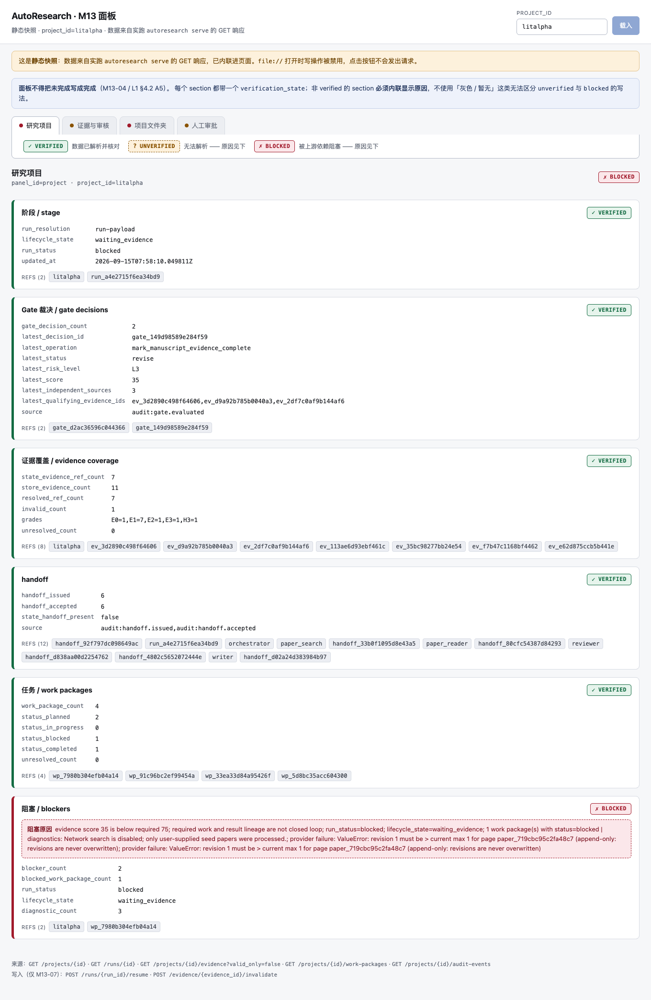

<p align="right">
  <strong>English</strong> · <a href="./README_ZH.md">简体中文</a>
</p>

# AutoResearch — Evidence-Governed Multi-Agent Research Workflow

An evidence-bounded, workspace-ledger-backed **LangGraph multi-agent research pipeline** (`149` Python modules, `92` test suites, `134` independent commits). It covers idea decomposition, literature search, structured paper reading, innovation synthesis, experimental work-packages, drafting, independent review, and experience accumulation.

<p align="center">
  
  <br />
  <sub>Project workspace & evidence-tracked research workbench</sub>
</p>

<p align="center">
  
  <br />
  <sub>5-agent workflow bounded by deterministic evidence gates and state machine services</sub>
</p>

---

## Architecture Principles

- **Strictly 5 Business Agents**: Coordinator, Paper Search, Paper Reader, Writer, and Reviewer — cleanly scoped without inflating orchestration glue into fake agents.
- **Deterministic Governance Services**: Evidence ledgers, `L0–L4` release gates, three-state loop-closure checks, state machines, and knowledge graphs are enforced by deterministic code.
- **Non-Resumable Policy Refusals & Gap-Honest Drafting**: When gates deny a transition or experimental results are absent, the pipeline halts or emits explicitly gap-marked research drafts rather than hallucinating conclusions.

---

## Quickstart & Documentation

```bash
python3 -m venv .venv
source .venv/bin/activate
pip install -e ".[dev]"
autoresearch doctor
autoresearch init-project demo "Evidence-aware agents"
autoresearch run demo --idea "Impact of deterministic evidence gates on multi-agent research reliability"
autoresearch serve --host 127.0.0.1 --port 8010
```

- [Architecture Overview](docs/ARCHITECTURE.md) · [Workflow & State Machine](docs/WORKFLOW_AND_STATE.md) · [Evidence & L0–L4 Gates](docs/EVIDENCE_AND_GATES.md) · [API Reference](docs/API.md)
