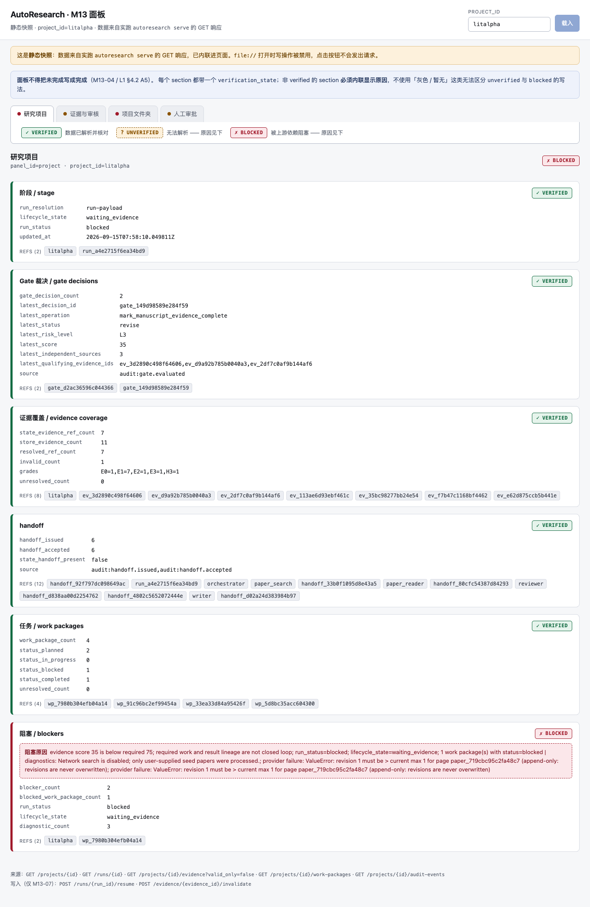

<p align="right">
  <a href="./README.md">English</a> · <strong>简体中文</strong>
</p>

# AutoResearch — 以证据门禁为边界的 LangGraph 多 Agent 科研工作流

一个以证据为边界、以项目文件夹为账本的 **LangGraph 多 Agent 科研工作流系统**（`149` 个 Python 模块、`92` 套测试、`134` 次独立提交）。完整覆盖 Idea 拆解与深化、论文检索、阅读总结、创新点候选、实验工作包、写作、独立审核与经验沉淀。

<p align="center">
  
  <br />
  <sub>AutoResearch 项目工作台与证据链状态视图</sub>
</p>

<p align="center">
  
  <br />
  <sub>五大业务 Agent 与确定性门禁/状态机服务分层架构</sub>
</p>

---

## 核心工程设计

- **严格维持五个业务 Agent**：总控 Agent、论文搜索 Agent、论文读取 Agent、写作 Agent、审核 Agent，职责边界清晰。
- **确定性服务做硬约束**：证据账本、L0–L4 门禁、三态闭环检查、状态机、知识库与经验沉淀均为确定性代码服务，绝不伪装成额外 Agent。
- **不可越级的拒绝策略与诚实草稿**：门禁拒绝时工作流不可恢复性越级；缺少实验结果时，写作 Agent 只能输出明确标记缺口的研究草稿。

---

## 快速开始与文档入口

```bash
python3 -m venv .venv
source .venv/bin/activate
pip install -e ".[dev]"
autoresearch doctor
autoresearch init-project demo "Evidence-aware agents"
autoresearch run demo --idea "研究证据门禁对多 Agent 科研可靠性的影响"
autoresearch serve --host 127.0.0.1 --port 8010
```

- [总体架构与五 Agent](docs/ARCHITECTURE.md) · [状态机与交接](docs/WORKFLOW_AND_STATE.md) · [证据等级与 L0–L4 门禁](docs/EVIDENCE_AND_GATES.md) · [API 文档](docs/API.md)
